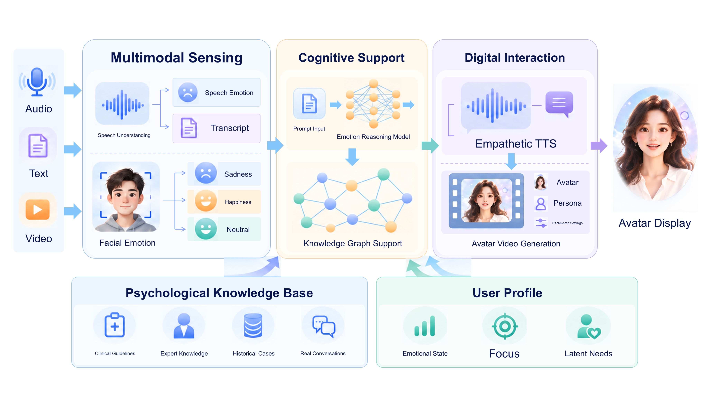

<p align="center"><strong>English</strong> · <a href="README.md">简体中文</a></p>

<h1 align="center">Beyond Reactive Comfort: A Knowledge-Enhanced Multimodal Agent with Long-Term Memory for Proactive Emotional Care</h1>

<h3 align="center">A Multimodal Emotional Care Agent with Psychological Knowledge and Long-Term Memory</h3>

<p align="center">Multimodal Emotion Perception · Psychological Knowledge Retrieval · Personal Long-Term Memory · Real-Time Avatar Interaction</p>

<p align="center"></p>

<p align="center">
  
  
  
  
  
</p>

<p align="center"><a href="#project-overview">Overview</a> · <a href="#ditto-checkpoints">Ditto checkpoints</a> · <a href="#personavlm-setup">PersonaVLM setup</a> · <a href="#system-startup">System startup</a> · <a href="#reproduction-status">Reproduction status</a></p>

---

## Changelog

| Date | Update |
| --- | --- |
| 2026-10-14 | Added the reference GPU environment: NVIDIA RTX PRO 6000. |
| 2026-10-13 | Removed competition-demo leftovers while retaining the national-finals real-time interaction code; standardized the project name as EmoCompanion and the frontend directory as `web/`. |
| 2026-10-13 | Added official Ditto and PersonaVLM checkpoint, paper, startup, and external-service documentation. |

## System architecture

<p align="center">
  
</p>

**Figure 1.** The paper's overall architecture: multimodal emotion analysis, cognitive intervention, presentation and interaction, data construction with a psychological knowledge base, and the user profile form the emotional-care loop. This is the paper-level system view; concrete services, models, and external dependencies are specified in the configuration sections below.

<a id="project-overview"></a>

## Project overview

EmoCompanion targets everyday emotional support and long-term companionship. Its service pipeline follows “perception, retrieval, reasoning, expression, and memory update”. Given text, audio, or video input, it combines multimodal emotional cues, personal interaction history, and psychological knowledge to generate a response, then delivers it through speech synthesis and a Ditto-driven real-time avatar.

The paper focuses on integrating multimodal perception, psychological knowledge, personal long-term memory, selective memory updates, and avatar output into an executable service chain rather than retraining a foundation model. The current code is based on the national competition implementation; paper descriptions, historical demonstration metrics, and reproducible measurements from this repository must be distinguished.

## Overview

This repository contains the code for *Beyond Reactive Comfort: A Knowledge-Enhanced Multimodal Agent with Long-Term Memory for Proactive Emotional Care*. It is based on the national competition implementation and retains the third-party component directories `LiveTalking`, `ditto-talkinghead`, and `PersonaVLM`.

## Repository layout

- `web/`: Vue frontend, normally served at `http://localhost:9010`.
- `LiveTalking/`: application APIs, WebRTC, TTS, ASR/emotion interfaces, and LightRAG forwarding.
- `Audio-Emotion-Analysis/`: separately managed uv service with local Qwen2-Audio ASR/emotion and DeepFace, plus a cloud PersonaVLM adapter and inactive EmoLLM/TTS resources. See the [service analysis](docs/Audio服务代码分析_20261014.md).
- `ditto-talkinghead/`: Ditto inference implementation called by LiveTalking.
- `PersonaVLM/`: long-term memory and personalized response API.
- `config.env.example`: a credential-free Linux/WSL configuration template; copy it to the local, ignored `config.env` and fill in the values. `start_emocompanion.sh` is the integrated launcher.

## Official implementations and papers

- Ditto: [code](https://github.com/antgroup/ditto-talkinghead), [paper](https://arxiv.org/abs/2411.19509), [Hugging Face checkpoints](https://huggingface.co/digital-avatar/ditto-talkinghead).
- PersonaVLM: [code](https://github.com/MiG-NJU/PersonaVLM), [paper](https://arxiv.org/abs/2604.13074), [Hugging Face checkpoints](https://huggingface.co/ClareNie/PersonaVLM).

This project integrates these components without retraining them. The official standalone demos, training datasets, and evaluation datasets are not required for this application.

<a id="ditto-checkpoints"></a>

## Ditto checkpoints

The source tree does not retain these large files. Download them from ModelScope first, then use the directory layout below as the deployment target.

The current launcher uses the PyTorch pipeline. Download the official files with Git LFS, then copy `ditto_cfg/` and `ditto_pytorch/` into the project-level `checkpoints/` directory:

```bash
cd EmoCompanion
git lfs install
git clone https://huggingface.co/digital-avatar/ditto-talkinghead /tmp/ditto-checkpoints
mkdir -p checkpoints
cp -r /tmp/ditto-checkpoints/ditto_cfg checkpoints/
cp -r /tmp/ditto-checkpoints/ditto_pytorch checkpoints/
```

The required files include `ditto_cfg/v0.4_hubert_cfg_pytorch.pkl`, the auxiliary ONNX models, and the six PyTorch model files under `ditto_pytorch/models/`. Set `DITTO_DATA_ROOT`, `DITTO_CFG_PKL`, and `DITTO_SOURCE_PATH` in `config.env`. The source path must point to an existing portrait image. ONNX/TensorRT checkpoints are available upstream but are not the default path here and depend on GPU architecture.

<a id="personavlm-setup"></a>

## PersonaVLM setup

After deployment, `PersonaVLM/checkpoints/rl`, CLIP, and MiniLM must be present. The source tree does not retain these large files; restore them using the [ModelScope resource download](#modelscope-resources) section.

The official PersonaVLM release requires Python 3.10 and `transformers==4.51.3`. Download the fine-tuned model into `PersonaVLM/checkpoints/rl`, then prepare the local retrieval models:

```bash
cd EmoCompanion/PersonaVLM
git clone https://huggingface.co/ClareNie/PersonaVLM /tmp/personavlm-checkpoints
mkdir -p checkpoints/rl
cp -r /tmp/personavlm-checkpoints/* checkpoints/rl/
git clone https://huggingface.co/openai/clip-vit-base-patch32 checkpoints/openai-clip
git clone https://huggingface.co/sentence-transformers/all-MiniLM-L6-v2 checkpoints/sentence-transformers/all-MiniLM-L6-v2
```

CLIP is used for image retrieval and MiniLM for text retrieval. The first image-memory operation may also download a GroundingDINO detector. A CUDA GPU with bfloat16 support is required by the current model loader.

```bash
conda activate PersonaVLM
pip install -r requirements.txt
python api_server.py --host 0.0.0.0 --port 9001 \
  --model-path ./checkpoints/rl --output-root ./output --preload-model
```

Verify `GET http://127.0.0.1:9001/ready` returns HTTP 200. A healthy `/health` response alone does not prove that the model is loaded.

<a id="modelscope-resources"></a>

## Download project resources from ModelScope

All project checkpoints are published in the [AGAiChiChaoFen/EmoCompanion](https://modelscope.cn/datasets/AGAiChiChaoFen/EmoCompanion) dataset repository. It contains Ditto, PersonaVLM, CLIP, MiniLM, Qwen2-Audio, Qwen3-TTS, EmoLLM, and DeepFace resources. The downloaded `checkpoints/`, `PersonaVLM/`, and `Audio-Emotion-Analysis/` directories should be merged directly into the project root; do not add an extra `EmoCompanion-resources/` directory level.

Install the ModelScope SDK in a separate Python environment and download the public dataset:

```bash
python -m pip install modelscope
python - <<'PY'
from modelscope.hub.snapshot_download import dataset_snapshot_download

dataset_snapshot_download(
    dataset_id="AGAiChiChaoFen/EmoCompanion",
    local_dir="./EmoCompanion-resources",
)
PY
```

Merge the downloaded resources on Linux/WSL:

```bash
rsync -a EmoCompanion-resources/checkpoints/ EmoCompanion/checkpoints/
rsync -a EmoCompanion-resources/PersonaVLM/checkpoints/ EmoCompanion/PersonaVLM/checkpoints/
rsync -a EmoCompanion-resources/Audio-Emotion-Analysis/ EmoCompanion/Audio-Emotion-Analysis/
```

On Windows PowerShell:

```powershell
robocopy D:\EmoCompanion-resources\checkpoints .\checkpoints /E
robocopy D:\EmoCompanion-resources\PersonaVLM\checkpoints .\PersonaVLM\checkpoints /E
robocopy D:\EmoCompanion-resources\Audio-Emotion-Analysis .\Audio-Emotion-Analysis /E
```

The commands merge files and do not use `/MIR`, so they do not delete existing project files. After merging, check `checkpoints/ditto_pytorch/`, `PersonaVLM/checkpoints/rl/`, `PersonaVLM/checkpoints/openai-clip/`, `PersonaVLM/checkpoints/sentence-transformers/all-MiniLM-L6-v2/`, `Audio-Emotion-Analysis/audio_emotion/pretrained_models/`, `Audio-Emotion-Analysis/deepface_weights/`, and `Audio-Emotion-Analysis/checkpoints/`.

Verify the main-project resources with:

```bash
cd EmoCompanion
python scripts/verify_resources.py --hash
```

This check covers the main Ditto, PersonaVLM, CLIP, and MiniLM resources. The Audio service resource manifest and SHA-256 list are in `weights_manifest.json`; configure its paths using `Audio-Emotion-Analysis/deployment.env.example`. The resource repository excludes `.env` files, access tokens, user memories, and runtime logs. Original third-party licenses remain applicable; see `WEIGHTS_README.md` in the downloaded snapshot.

<a id="system-startup"></a>

## System startup

The integrated launcher targets Linux/WSL, not native PowerShell. Copy `config.env.example` to the local `config.env` first, then configure the Conda path and environment, GPU, ports, model paths, external service URLs, and credential placeholders.

```bash
cd EmoCompanion
bash start_emocompanion.sh
```

The script starts PersonaVLM on port 9001 and LiveTalking on port 9000 by default. Start the frontend separately:

```bash
cd EmoCompanion/web
npm install
npm run dev -- --host 0.0.0.0 --port 9010
```

Open `http://localhost:9010/integrated-system`. `npm run build` only builds the frontend; it does not start model or backend services.

<a id="reproduction-status"></a>

## Remaining reproduction requirements

The repository is not currently an end-to-end runnable package without additional setup:

1. Model files have been removed from this local source tree and are published in [AGAiChiChaoFen/EmoCompanion](https://modelscope.cn/datasets/AGAiChiChaoFen/EmoCompanion). Download the model files and place them in the directory structure described above.
2. The reference hardware is an NVIDIA RTX PRO 6000. Also prepare Linux/WSL, CUDA, compatible PyTorch/TensorRT/FFmpeg dependencies, and a Conda environment. Other GPUs require a fresh check of memory, CUDA, TensorRT, and bfloat16 support.
3. Keep dependency versions isolated: PersonaVLM requires `transformers==4.51.3`, while `LiveTalking/requirements.txt` pins `transformers==4.46.2`.
4. Deploy the included `Audio-Emotion-Analysis` service with its own uv environment and updated model paths; its `/asr` contract matches `QWENAUDIO_API_URL`.
5. The included DeepFace `/face-emotion` runs in the same port-9100 service. Align `DEEPFACE_API_URL` at deployment, or retain the original separate port-9020 service.
6. Prepare the LightRAG service and knowledge base configured by `LIGHTRAG_BASE_URL` (port 9622 by default).
7. Configure valid Qwen3-TTS/DashScope credentials and a reachable TURN service for public-network WebRTC.
8. Default portrait and voice/avatar assets are included. Scripted demo memories are excluded; actual interactions populate user memory. Select the frontend user with `VITE_PERSONA_USER_NAME`. The current Persona HTTP route sends text and emotion; upstream image-memory extensions still require GroundingDINO dependencies.

Main-project resource integrity, frontend build, and regression checks were verified earlier. ASR and DeepFace sources and weights are now included and statically checked; existing integration settings are preserved. The archive contains EmoLLM, not Emotion-LLaMA, and its EmoLLM/TTS routes are inactive. GPU inference and end-to-end operation still require deployment testing.

## Archived materials

Legacy deployment notes, prerecorded videos, unused mock data, and recording scripts are stored under `清理暂存/` at the paper project root and are not used at runtime.
